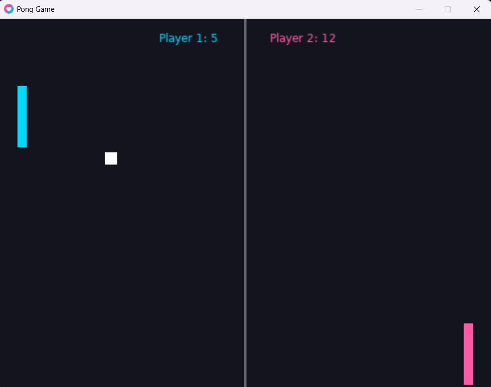

# Pong Game 🎮

**Name:** Hala Shream  

## About the Game

This is a simple Pong game made using Lua and the LÖVE2D framework. Two players can play together and control their paddles to hit the ball. The game includes ball movement, wall bouncing, paddle collision, and a score counter.

## How to Run

Make sure LÖVE2D is installed on your computer.

Open the project folder in the terminal and run:

```bash
love .
```

## Controls

- **Player 1:** W to move up, S to move down.
- **Player 2:** Up Arrow to move up, Down Arrow to move down.

## My Own Feature

I added a scoring system to the game. Players get a point when they hit the ball with their paddle. If the ball goes out from the left side, Player 2 gets a point. If it goes out from the right side, Player 1 gets a point. The top and bottom walls only make the ball bounce.

I also gave each paddle a different color.

## Screenshot




## Demo Video

[Watch the Pong Game Demo](demo/pong-demo.mp4)
